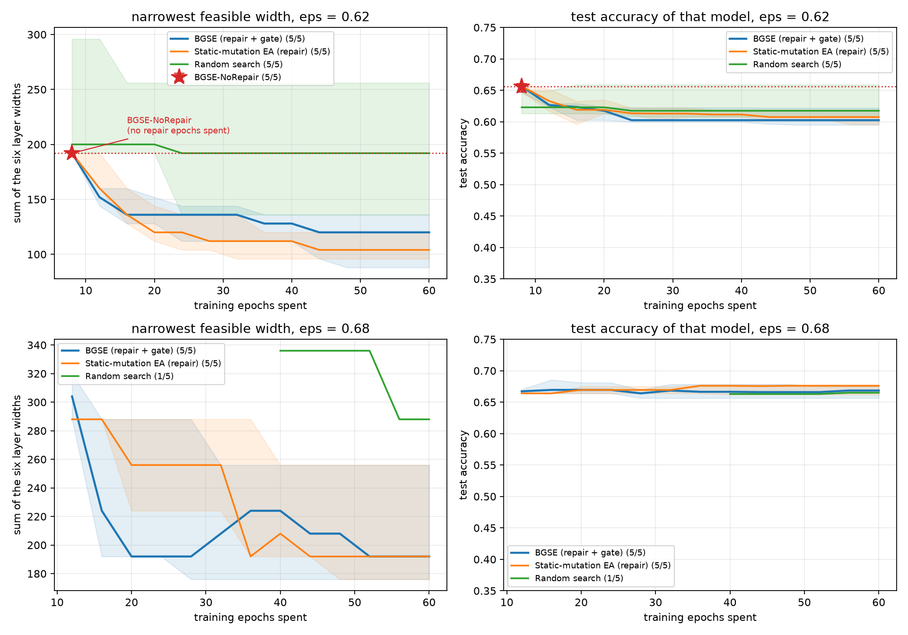

# End-to-end width search on CIFAR-10

Backbone: 6-layer CNN, per-layer width in {8,16,32,64}. 10k train / 2k validation / 10k test.
Budget: a fixed number of training epochs; 5 seeds.
Epsilon is a validation-accuracy threshold; the objective is lexicographic (feasible first, then fewest parameters).
Curves are the median across seeds; a seed enters only once it has found a feasible model, so the median can move up when another seed joins. Bands are [min-max].

## Champion per run

## epsilon: validation accuracy >= 0.62

| method | feasible | width sum | params | val acc | test acc (10k) | retrained test (10k) | epochs to best |
|---|---|---|---|---|---|---|
| BGSE (repair + gate) | 5/5 | 120 [88-136] | 17,130 | 0.6220 | 0.6086 [0.6042-0.6196] | 0.6085 [0.5968-0.6245] | 40 |
| Static-mutation EA (repair) | 5/5 | 104 [96-120] | 13,426 | 0.6225 | 0.6077 [0.5956-0.6219] | 0.5996 [0.5722-0.6155] | 29 |
| Random search | 5/5 | 192 [136-256] | 49,962 | 0.6285 | 0.6234 [0.6108-0.6557] | 0.6237 [0.6054-0.6423] | 16 |
| BGSE-NoRepair | 5/5 | 192 [192-192] | 47,658 | 0.6665 | 0.6573 [0.6439-0.6644] | 0.6533 [0.6415-0.6583] | 8 |

## epsilon: validation accuracy >= 0.68

| method | feasible | width sum | params | val acc | test acc (10k) | retrained test (10k) | epochs to best |
|---|---|---|---|---|---|---|
| BGSE (repair + gate) | 5/5 | 192 [176-256] | 47,658 | 0.6830 | 0.6702 [0.6619-0.6758] | 0.6467 [0.6415-0.6581] | 36 |
| Static-mutation EA (repair) | 5/5 | 192 [176-256] | 47,658 | 0.6825 | 0.6758 [0.6585-0.6776] | 0.6581 [0.6441-0.6642] | 39 |
| Random search | 1/5 | 288 [288-288] | 112,362 | 0.6825 | 0.6714 [0.6714-0.6714] | 0.6718 [0.6718-0.6718] | 56 |
| BGSE-NoRepair | 0/5 | - | - | - | - | - |

## What the figure shows

**Repair is the load-bearing step.**

- At the strict budget (validation accuracy >= 0.68) BGSE-NoRepair finds no
  feasible model in any of the five seeds. Without an epoch to recover after a
  structural change, every child is scored worse than its parent, so the search
  never leaves the 192-wide mother - and the mother itself misses the budget
  (validation 0.6665).
- At the loose budget (>= 0.62) the same effect shows up as width: NoRepair
  stays at 192 while BGSE reaches 120 [88-136] and static-mutation EA 104
  [96-120]. Random search, which trains every candidate from scratch, needs
  192 [136-256] for the same compute.
- The price of sitting on the boundary is lower test accuracy (0.609 for BGSE
  at 0.62 against 0.657 for the wide mother). That is the objective working as
  specified: among feasible models, the narrowest wins.

**The gate is not the hero.** Static 50/50 mutation with repair ties BGSE at
the strict budget (both 192 [176-256]) and is slightly narrower at the loose
one (104 vs 120). This matches the tabular benchmark, where the gate only
helped inside a population search. What both repair methods share - and what
NoRepair lacks - is the repair step itself.

**Compute is charged honestly.** Every repair epoch counts against the same
60-epoch budget as a from-scratch training, so NoRepair's zero-epoch children
do not buy it free samples and random search pays in full for each 8-epoch
model. `retrained test` re-trains each winning width vector from scratch, so
the accuracy comparison is not confounded by BGSE's models being warm-started.

## Caveats

- 10k training images and 8 epochs per from-scratch model keep this on a
  laptop; absolute accuracies are 0.60-0.68, not CIFAR-10 SOTA.
- 5 seeds, medians with [min-max]. One width step is one layer moving 32->16
  or 16->8, so a one-step difference is inside seed noise.
- The demo's mutation has a 0.40 "value-only" branch (weight jitter). With no
  weights to jitter before repair, that branch is mapped here to a random
  width change; the mapping is a design choice and may be part of why the gate
  does not separate from static mutation.
- NoRepair spends zero epochs per child by construction, so its marker sits at
  the mother's 8 epochs; the dotted guide is a reference, not spend.

